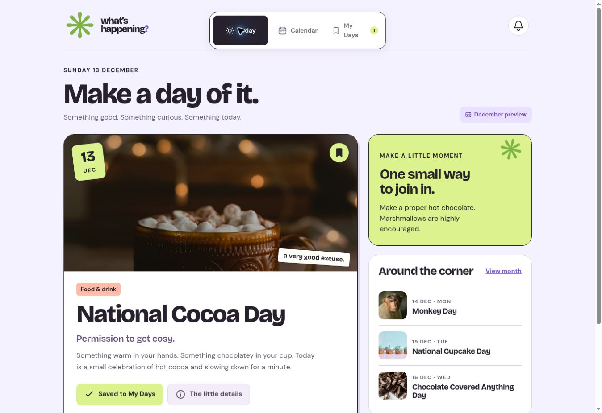
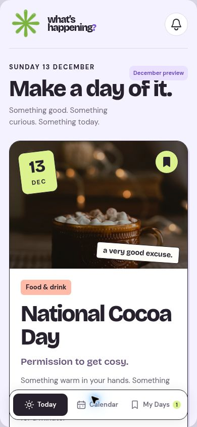
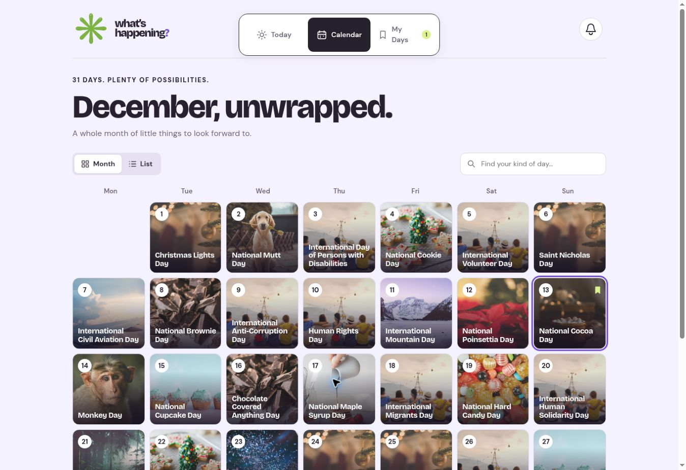

# What’s Happening?

**Make a day of it.** A playful, mobile-first calendar of the interesting things happening on a date.

This is a design draft for review, with exactly **one event per day in December 2026**. The three working tabs are Today, Calendar and My Days. It uses bundled stock photography, original short descriptions, bold typography, lilac and lime colours, and little paper-like date stickers.

## Design preview







## Run it

Requires Node.js 20.11 or newer. No dependency installation, account, API key or paid API is needed.

```sh
npm start
```

Open `http://localhost:3000`. Any static host can also serve the repository root. Use HTTPS for install/offline/notification features, except on localhost.

```sh
npm run check
npm test
```

## Try the draft

- **Today:** a large stock photo, the event, a short explanation, an idea for joining in, and upcoming days. Outside December 2026, it explicitly previews 13 December. Browse the other dates with the previous/next controls.
- **Calendar:** December 2026, starting on Tuesday, with a photo grid and a readable list. The phone layout opens in list view. Search events by title or category, then tap for details.
- **My Days:** save and remove events. Saves and reminder preferences persist in this browser. Export the saved events as an `.ics` calendar file, with an extra reminder at the chosen local time.
- **Reminders:** choose a daily discovery time and a separate saved-day reminder. Browser notification permission is requested only when you press Enable. A preview notification is available after permission is granted.
- **Offline:** the app shell and event images are cached after a successful first visit. On compatible browsers, add it to the home screen.

## What is deliberately still a draft

This is a web prototype, not an Android APK. Browser alerts are checked while the app is open; **scheduled alerts while closed need a later native notification or push implementation**. The calendar export is the current route to reminders while closed. Calendar apps may interpret all-day alarms differently, so check the imported reminder time in the destination app.

There is no account or cross-device sync. Saved days stay on the device/browser where they were saved. Removing an event here cannot remove an event already imported into another calendar.

Content is a small editorial selection rather than an exhaustive observance database. Informal US food days are labelled, alongside international and cultural dates. Deeper research, more events per day, more months and custom artwork are deferred until the visual direction is approved. Stock photos are illustrative, and some are reused or show a related theme.

See [photo credits](PHOTO-CREDITS.md) for the bundled stock images and [Days Of The Year’s December page](https://www.daysoftheyear.com/days/dec/) for the initial event references. Event copy is original; this project is not affiliated with Days Of The Year.
Days of the year notifications 
